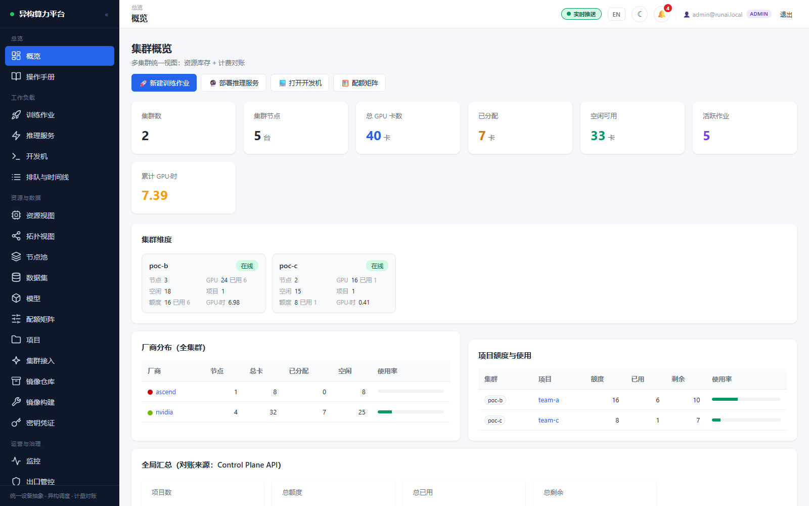
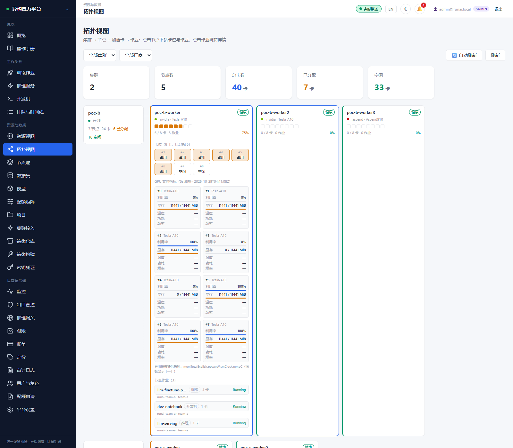
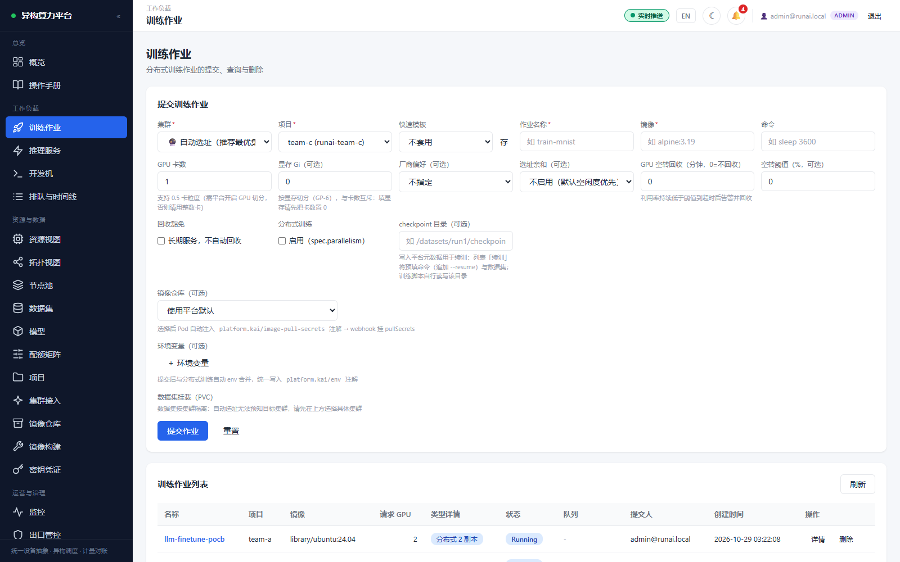
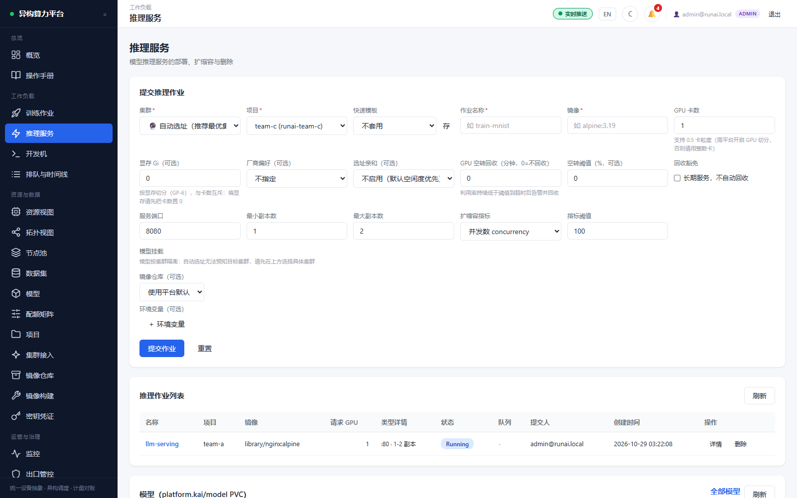
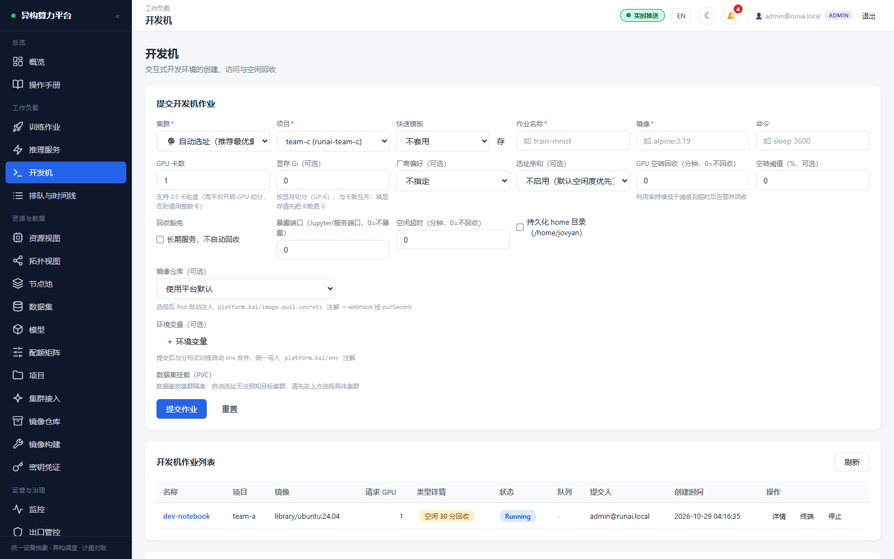
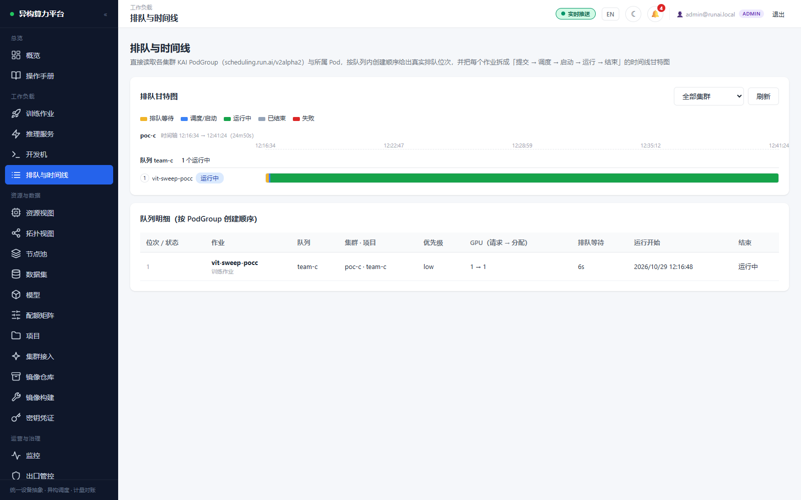
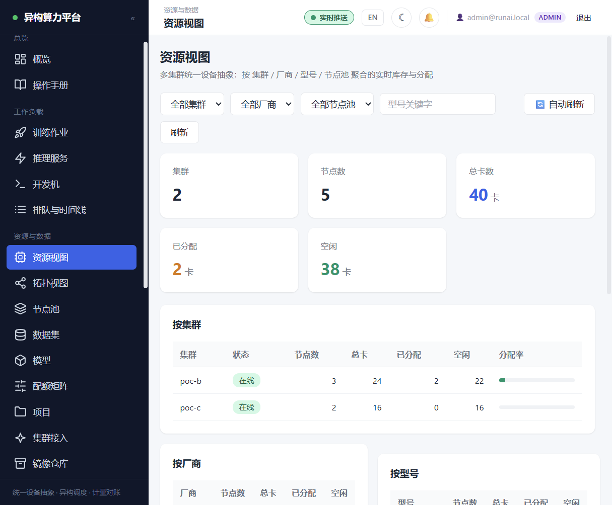
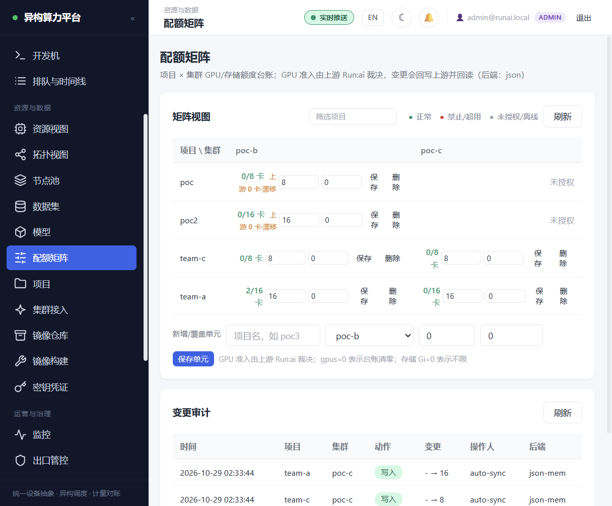

# 异构算力运营平台 · 运行效果展示

面向多集群算力运营的业务管控面：在不替代集群调度器的前提下，提供跨控制面聚合、异构厂商抽象、计费与对账、审批审计，以及数据集等平台资产台账。

> **本仓库是运行效果与架构的公开展示**，包含产品简介、真实运行截图与架构文档。
> 完整源码仓库暂不公开；如需深入阅读代码、部署脚本或技术交流，见文末[联系与交流](#联系与交流)。

- 版本：`0.1.1`（2026-10-29），0.x 预发布
- 技术栈：Go 业务控制面 · Vue 3 控制台 · PostgreSQL · Prometheus · Helm 交付
- 上游适配：开源 Run:ai OSS 与 KAI Scheduler（Apache-2.0，仅通过 API 集成，不分发其源码）

## 界面速览

| 概览（双集群统一视图） | 拓扑视图 · 选中节点展开详情 |
| --- | --- |
|  |  |

| 训练作业（提交与列表） | 推理服务 |
| --- | --- |
|  |  |

| 开发机 | 排队与时间线 |
| --- | --- |
|  |  |

| 资源视图（异构设备） | 配额矩阵 |
| --- | --- |
|  |  |

截图为**双集群在线环境**的真实界面，不是设计稿：`poc-b` 接入 3 个 GPU 节点 / 24 张加速卡（16 张 NVIDIA Tesla-A10 + 8 张 Ascend910），`poc-c` 接入 2 个节点 / 16 张 Tesla-A10，合计 5 节点 / 40 张卡；训练作业 `llm-finetune-pocb`（poc-b，2 GPU 分布式）与 `vit-sweep-pocc`（poc-c，1 GPU）、推理服务 `llm-serving`（Knative）、开发机 `dev-notebook` 均处于 Running。

其中拓扑视图是这一版的重点：点选任一节点卡片会就地展开该节点的详情——GPU 槽位占用、DCGM 实时利用率（数据来自集群内 Prometheus）、该节点上绑定的工作负载（可直接跳到作业详情），既能看到「哪张卡被谁占着」，也能解释排队是怎么发生的。Portal 以独立镜像部署为独立 Pod（nginx 托管静态资源 + 反向代理后端 API），与控制面解耦。

## 平台做什么、不做什么

| 方向 | 平台职责 | 不承担的职责 |
| --- | --- | --- |
| 跨控制面聚合 | 汇总集群、项目、库存和工作负载视图 | 不在平台内另写一套工作负载状态机 |
| 异构厂商抽象 | 厂商偏好、统一资源描述、资源名翻译、按厂商计价 | 不做 Pod 到节点的绑定或节点评分 |
| 计费与对账 | 计量归集、价格、账单、额度和对账台账 | 不把调度器的配额语义复制成第二执行面 |
| 审批与审计 | 配额申请、审批记录、平台操作审计 | 不以本地审批结果冒充上游配置已生效 |
| 平台资产 | 数据集台账、扩展元数据和引用关系 | 不重复持久化上游已有的权威主数据 |

集群内排队、配额准入、Gang、抢占及 Pod 生命周期由上游调度控制面负责。NVIDIA、Run:ai、KAI 等名称归各自权利人所有，仅用于说明集成对象；本项目与上述厂商无关联、未获背书，也不以对方品牌对外命名。

## 架构与职责边界

详见 [docs/architecture.md](docs/architecture.md)。核心设计是四条集成红线：

1. **不写节点级调度**——不设置 Pod `nodeName`，不维护节点绑定结果，不新增节点评分循环。
2. **配额只有一个执行决策点**——平台审批后调用上游写接口并回读，`approved` ≠ `synced`，失败进入可重试、可审计状态。
3. **工作负载实时状态以上游为准**——平台不持久化私有权威 phase/conditions；历史快照必须带采集时间。
4. **只持久化上游没有的数据**——官方项目、成员、配额和状态实时只读聚合，不复制成第二真源。

## 当前成熟度

`0.1.1` 的 7 项预发布整改（多集群显式绑定、GPU 配额第二执行面、认证与代理、portal 生产代理、作业链路授权、差异化实证、发行路径决策）已于 2026-10-28 全部关闭。运维侧已具备：平台状态（PostgreSQL + 台账）备份脚本与恢复演练（按表数量比对通过，279 / 11 张表）、Prometheus 告警规则与 Alertmanager 接入、一条命令的本机完整试用编排。

尚未达到投产口径的部分：仅验证过 kind 集群形态；TLS 为自签 CA；生产升级窗口与回滚策略需按交付环境另行定义。文档不会把上述待办写成既有生产能力。

## 联系与交流

源码暂不公开，但关于运行效果复现、架构设计、部署方式或技术交流，都可以直接联系作者：

| 渠道 | 地址 | 适用场景 |
| --- | --- | --- |
| 邮件 | <mathes006@126.com> | 最直接；通常 1–2 个工作日内回复 |
| Issue | <https://github.com/dianduji-20008/hetero-compute-platform-showcase/issues> | 文档错误、截图/描述与实现不符、公开提问 |
| GitHub | [@dianduji-20008](https://github.com/dianduji-20008) | 其他公开交流 |

需要阅读源码或参与部署验证的，请在邮件中说明用途与背景，我会按情况提供访问方式或安排交流。

## 许可证

本仓库内容采用 [Apache License 2.0](LICENSE)。
