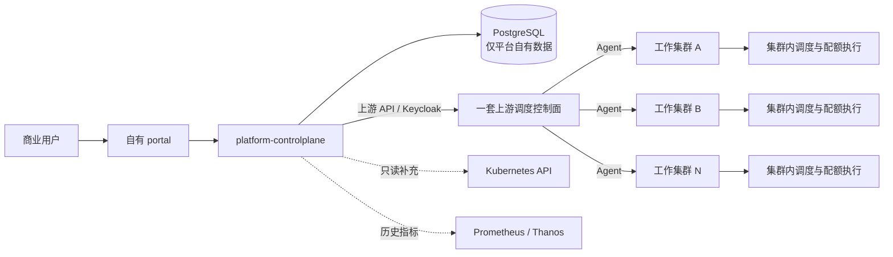
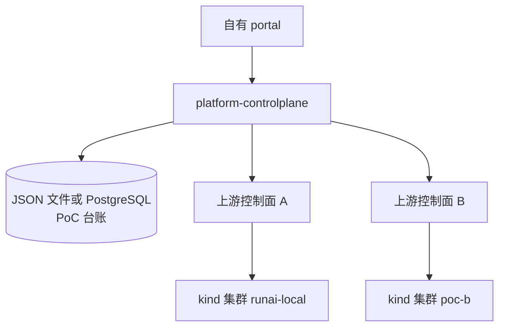

# 架构与职责边界

版本：2026-10-29（公开展示摘编；完整设计文档归档于源码仓库）。

## 1. 目标拓扑

平台是跨控制面的业务运营层，不包含数据面调度组件。标准生产目标是“一套上游调度控制面、多个工作集群”，而不是每个工作集群再复制一套上游控制面。

关键约束：

- portal 只访问平台业务入口，不直接持有上游集成账号或集群凭据。
- 平台选址的对象是**集群**；节点选择、排队、Gang、抢占和最终配额准入由上游完成。
- PostgreSQL 保存计费、对账、审批、审计、数据集台账及平台扩展元数据，不保存另一套上游权威状态。
- Kubernetes API 只用于库存、事件、日志等只读补充，以及平台自有资源的必要管理。

## 2. 当前本机 PoC 拓扑

当前开发环境是两个 kind 集群、两套相互独立的上游控制面。它只能用于开发联调，不能作为生产数据模型。

多集群显式绑定整改已于 2026-10-28 完成（工作负载按 clusterId 归属并去重）；上图保留两套上游控制面的本机形态，仅用于开发联调，不作为生产数据模型。

## 3. 控制面与数据面分工

| 层级 | 组件 | 职责 |
| --- | --- | --- |
| 展现层 | 自有 portal | 业务表单、跨集群视图、账单、审批、审计和中英文操作手册 |
| 业务控制面 | platform-controlplane | 聚合、策略编排、厂商偏好翻译、计量计费、平台资产台账 |
| 平台数据层 | PostgreSQL / 本地 PoC 台账 | 只持久化平台自有数据；短 TTL 缓存必须可丢弃、可重建 |
| 上游控制面 | 当前适配 Run:ai OSS | 身份、项目与工作负载主数据、官方 API、集群注册 |
| 集群数据面 | 上游 Agent 与调度组件 | 队列、配额执行、工作负载状态机、Pod 生命周期和实际调度 |
| 可观测补充 | Prometheus / Kubernetes API | 历史指标、库存、Pod 事件与日志的只读补充 |

## 4. 四条集成红线

1. **不写节点级调度。** 不设置 Pod `nodeName`，不维护节点绑定结果，不新增节点评分循环。
2. **配额只有一个执行决策点。** 平台审批后调用上游写接口并回读；`approved` 不等于 `synced`，失败进入可重试、可审计状态。
3. **工作负载实时状态以上游为准。** 平台不持久化私有权威 phase/conditions；历史快照必须带采集时间。
4. **只持久化上游没有的数据。** 官方项目、成员、配额和状态优先实时只读聚合，不复制成第二真源。

## 5. 数据归属

| 数据 | 权威来源 | 平台处理 |
| --- | --- | --- |
| 工作负载 phase、conditions、失败原因 | 上游控制面 | 实时读取；必要时通过 Kubernetes 只读补充 |
| 官方执行配额 | 上游控制面 | 展示、申请、审批后回写并回读 |
| 项目与命名空间主数据 | 上游控制面 / Kubernetes | 只读聚合，不另建项目 CRUD |
| 价格、计量、账单、对账 | 平台 | 持久化、备份和审计 |
| 配额申请与审批记录 | 平台 | 持久化；审批状态与回写状态分离 |
| 数据集台账与平台扩展字段 | 平台 | 持久化；保存引用而非复制工作负载状态 |
| 平台操作审计 | 平台 | 记录真实终端用户，同时区分上游集成账号 |
| 短 TTL 项目或指标缓存 | 上游 / 指标后端 | 可过期、可重建，不作为权威存储 |

## 6. 信任与权限边界

- 终端用户身份由 Keycloak / 企业 IdP 签发，平台不建立另一套用户密码库。
- 上游集成账号与终端用户审计身份分开；集成账号按实际 API 清单最小授权。
- Kubernetes 凭据与上游账号分别最小化，不能因平台持有集成账号就放通全部管理面。
- 平台角色只控制平台业务功能，不能覆盖上游资源授权，也不能用“跨项目最高角色”代替项目级校验。
- 生产部署必须关闭离线开发兜底、启用凭据加密，并限制管理排障代理的方法与路径。
